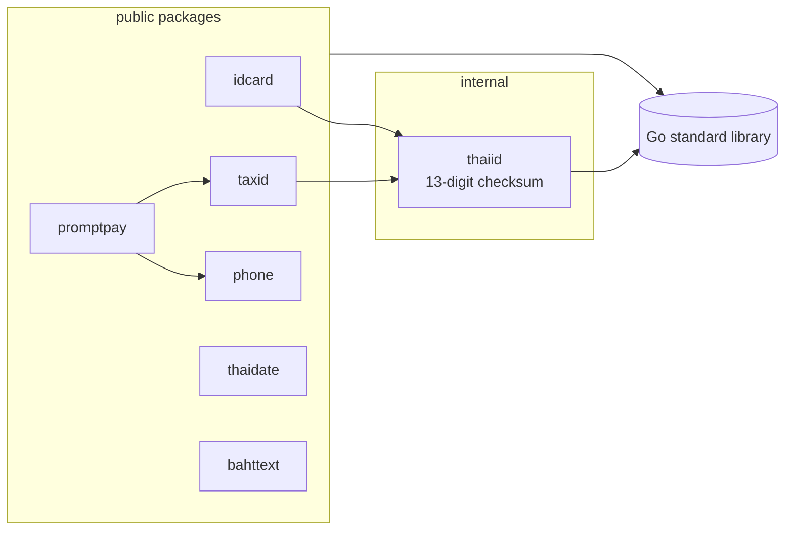

<div align="center">

# thai-utils

**Thailand-specific utilities for Go — national IDs, tax IDs, phone numbers, PromptPay QR, Buddhist-Era dates and baht text. Zero dependencies.**

[](https://github.com/tonklasocute/thai-utils/actions/workflows/ci.yml)
[](https://pkg.go.dev/github.com/tonklasocute/thai-utils)
[](https://goreportcard.com/report/github.com/tonklasocute/thai-utils)
[](go.mod)
[](#development)
[](go.mod)
[](LICENSE)

English · [ภาษาไทย](README.th.md)

</div>

```go
idcard.Validate("1-1037-02071-81-1")  // true
phone.ToE164("081-234-5678")          // "+66812345678"
promptpay.Payload("0812345678", nil)  // "000201010211…63045D82"
thaidate.Format(t, thaidate.DateFull) // "วันเสาร์ที่ 17 ตุลาคม พ.ศ. 2569"
bahttext.Format(1250.50)              // "หนึ่งพันสองร้อยห้าสิบบาทห้าสิบสตางค์"
```

| Package | What it does |
|---------|--------------|
| [`idcard`](#idcard) | Thai national ID (เลขประจำตัวประชาชน): checksum validation, formatting, test-data generation |
| [`taxid`](#taxid) | Thai tax ID (เลขประจำตัวผู้เสียภาษี) for individuals and juristic persons |
| [`phone`](#phone) | Mobile and landline numbers: validate, normalize, E.164, display format |
| [`promptpay`](#promptpay) | EMVCo / Thai QR PromptPay payloads, static or with a fixed amount |
| [`thaidate`](#thaidate) | Buddhist Era (พ.ศ.) conversion, Thai month and weekday names, DD/MM/YYYY parsing, Thai digits |
| [`bahttext`](#bahttext) | Amounts in Thai words, like Excel's `BAHTTEXT` |

Every package follows the same rules: **standard library only**, forgiving input (dashes, spaces, `+66`)
with strict validation, [sentinel errors](#errors) for `errors.Is`, a runnable program in
[`examples/`](examples), and 100% test coverage.

## Install

```sh
go get github.com/tonklasocute/thai-utils
```

Requires Go 1.22 or newer. Import only the packages you need:

```go
import (
	"github.com/tonklasocute/thai-utils/idcard"
	"github.com/tonklasocute/thai-utils/promptpay"
)
```

---

## idcard

**Reject a mistyped ID before it reaches your database.** The 13th digit of a Thai national ID is a
mod-11 checksum, so most typos are caught offline. `Check` tells you *why* an ID is wrong, so you can
show the user a specific message instead of a generic "invalid".

```go
idcard.Validate("1-1037-02071-81-1")  // true
idcard.Validate("1103702071812")      // false: wrong check digit
idcard.Format("1103702071811")        // "1-1037-02071-81-1", nil
idcard.Normalize("1-1037-02071-81-1") // "1103702071811"
idcard.Generate()                     // e.g. "3849105732112"

switch err := idcard.Check(input); {
case errors.Is(err, idcard.ErrInvalidLength):
	// "เลขบัตรประชาชนต้องมี 13 หลัก"
case errors.Is(err, idcard.ErrInvalidChecksum):
	// "เลขบัตรประชาชนไม่ถูกต้อง"
}
```

```text
$ go run ./examples/idcard
1-1037-02071-81-1    valid   -> 1-1037-02071-81-1
1103702071812        invalid -> check digit mismatch
0105556000017        invalid -> idcard: personal ID must not start with 0
12345                invalid -> idcard: must contain exactly 13 digits
random test ID: 3803820267571
```

> [!WARNING]
> `Generate` is for test fixtures only. A random valid ID may belong to a real person.

---

## taxid

**One validator for both people and companies.** Individuals use their national ID as a tax ID;
juristic persons get a 13-digit number that starts with `0`. `taxid` accepts both and `IsJuristic`
tells them apart.

```go
taxid.Validate("0105556000017")   // true
taxid.IsJuristic("0105556000017") // true: company / juristic person
taxid.IsJuristic("1103702071811") // false: individual
taxid.Format("0105556000017")     // "0-1055-56000-01-7", nil
```

```text
$ go run ./examples/taxid
0105556000017        0-1055-56000-01-7 (juristic person)
1-1037-02071-81-1    1-1037-02071-81-1 (individual)
0105556000018        invalid: taxid: invalid check digit
```

---

## phone

**Store one format, display another.** Users type `+66 81 234 5678`, `(02) 123-4567` or `0812345678`;
`phone` turns all of them into a canonical form for storage, E.164 for SMS gateways and a readable
format for the UI.

```go
phone.Validate("+66 81 234 5678")  // true
phone.Normalize("+66 81 234 5678") // "0812345678", nil
phone.ToE164("081-234-5678")       // "+66812345678", nil
phone.Format("0812345678")         // "081-234-5678", nil
phone.Format("021234567")          // "02-123-4567", nil
phone.Format("053123456")          // "053-123-456", nil
phone.IsMobile("021234567")        // false
```

```text
$ go run ./examples/phone
input              display        E.164          type
0812345678         081-234-5678   +66812345678   mobile
+66 81 234 5678    081-234-5678   +66812345678   mobile
(02) 123-4567      02-123-4567    +6621234567    landline
053123456          053-123-456    +6653123456    landline
+1 415 555 0100    error: phone: country code must be +66
1669               error: phone: unknown number prefix
```

Mobile numbers are `06`/`08`/`09` plus 8 digits. Landlines are `02` (Bangkok) or `03`/`04`/`05`/`07` plus 7 digits.

---

## promptpay

**A PromptPay QR that every Thai banking app can scan.** Generates the EMVCo / Thai QR Payment payload
for a mobile number, a 13-digit national ID or tax ID, or a 15-digit e-wallet ID — static (the payer
enters the amount) or with a fixed amount. Output matches the
[`promptpay-qr`](https://github.com/dtinth/promptpay-qr) npm package byte for byte, verified by golden tests.

```go
// Static QR: the payer enters the amount.
payload, err := promptpay.Payload("081-234-5678", nil)

// Dynamic QR: fixed amount of ฿100.50 to a national ID.
payload, err = promptpay.Payload("1-1037-02071-81-1", promptpay.Amount(100.50))
// 00020101021229370016A000000677010111021311037020718115802TH53037645406100.5063041B0C
```

```text
$ go run ./examples/promptpay 0812345678 100
00020101021229370016A000000677010111011300668123456785802TH53037645406100.006304BB8A
```

<details>
<summary><b>Rendering the QR image</b></summary>

`thai-utils` stays dependency-free, so it returns the payload string and leaves the image to you. With [`skip2/go-qrcode`](https://github.com/skip2/go-qrcode):

```go
import (
	"github.com/skip2/go-qrcode"
	"github.com/tonklasocute/thai-utils/promptpay"
)

payload, err := promptpay.Payload("0812345678", promptpay.Amount(250))
if err != nil {
	return err
}
// Write a 256×256 PNG that any Thai banking app can scan.
err = qrcode.WriteFile(payload, qrcode.Medium, 256, "promptpay.png")
```

To serve it over HTTP, use `qrcode.Encode` to get the PNG bytes instead.

</details>

---

## thaidate

**Thai dates with the Go layouts you already know.** `Format` takes ordinary `time.Format` layouts:
`2006`/`06` become Buddhist Era years, `January`/`Jan` become Thai month names and `Monday`/`Mon`
become Thai weekday names. Every other token behaves exactly like `time.Format`.

```go
t := time.Date(2026, time.October, 17, 14, 30, 0, 0, time.UTC)

thaidate.ToBE(2026)                             // 2569
thaidate.ToCE(2569)                             // 2026
thaidate.Format(t, thaidate.DateLong)           // "17 ตุลาคม 2569"
thaidate.Format(t, thaidate.DateShort)          // "17 ต.ค. 69"
thaidate.Format(t, thaidate.DateFull)           // "วันเสาร์ที่ 17 ตุลาคม พ.ศ. 2569"
thaidate.Format(t, "Mon 2 Jan 2006 15:04 น.")   // "ส. 17 ต.ค. 2569 14:30 น."
thaidate.Parse("17/10/2569")                    // 2026-10-17 00:00:00 UTC, nil
thaidate.ToThaiDigits("17/10/2569")             // "๑๗/๑๐/๒๕๖๙"
```

```text
$ go run ./examples/thaidate
Long:    18 ตุลาคม 2569
Short:   18 ต.ค. 69
Full:    วันอาทิตย์ที่ 18 ตุลาคม พ.ศ. 2569
Time:    18 ตุลาคม 2569 เวลา 20:22 น.
Digits:  ๑๘ ตุลาคม ๒๕๖๙
Parsed 13/04/2569 -> 2026-04-13 (Songkran, CE 2026)
```

`Parse` reads DD/MM/YYYY in Buddhist Era and rejects dates that don't exist, such as `29/02/2569` or `31/04/2569`.

---

## bahttext

**The amount-in-words line on every Thai invoice and receipt.** Follows the same rules as Excel's
`BAHTTEXT`, including `เอ็ด`, `ยี่สิบ`, `ถ้วน` and repeated `ล้าน` for very large numbers.

```go
bahttext.Format(21)                    // "ยี่สิบเอ็ดบาทถ้วน"
bahttext.Format(1250.50)               // "หนึ่งพันสองร้อยห้าสิบบาทห้าสิบสตางค์"
bahttext.Format(0.25)                  // "ยี่สิบห้าสตางค์"
bahttext.Format(-100)                  // "ลบหนึ่งร้อยบาทถ้วน"
bahttext.FormatString("1,000,001.00")  // "หนึ่งล้านเอ็ดบาทถ้วน", nil
bahttext.FormatString("1000000000000") // "หนึ่งล้านล้านบาทถ้วน", nil
```

```text
$ go run ./examples/bahttext 1250.50 99.99
         1250.50  หนึ่งพันสองร้อยห้าสิบบาทห้าสิบสตางค์
           99.99  เก้าสิบเก้าบาทเก้าสิบเก้าสตางค์
```

Prefer `FormatString` for money that comes from user input or a decimal type. It works on decimal
strings of any size with exact half-up rounding, so `float64` precision never comes into play.

---

## Why I built this

I'm a developer from Bangkok, and almost every project I work on needs the same handful of Thai-specific
checks: validate a national ID on a sign-up form, normalize phone numbers before sending an OTP, print
a Buddhist-Era date on a document, put a PromptPay QR on an invoice, write the amount in Thai words on a
receipt. I kept copying the same snippets between projects — each a little different, some with subtle
bugs — so I collected them into one well-tested library with no dependencies, a consistent API and
errors you can actually show to users.

## Architecture

```text
thai-utils/
├── idcard/                 # national ID: Validate, Check, Format, Normalize, Generate
├── taxid/                  # tax ID: same API as idcard plus IsJuristic
├── phone/                  # mobile + landline parsing, E.164, display format
├── promptpay/              # EMVCo TLV payload builder, CRC16-CCITT, amount handling
├── thaidate/               # BE ↔ CE, layout translation on top of time.Format, Parse, Thai digits
├── bahttext/               # number → Thai words, arbitrary-size decimal strings
├── internal/thaiid/        # shared 13-digit mod-11 checksum used by idcard and taxid
├── examples/<package>/     # one runnable program per package
├── .github/workflows/      # CI: vet, lint, race tests on Linux/macOS/Windows, Go 1.22 & stable
├── .golangci.yml
└── Makefile
```



Design notes:

- **Zero dependencies.** Standard library only, so nothing transitive lands in your `go.sum`.
- **Small, independent packages.** Import `bahttext` without pulling in PromptPay. The only shared code is
  the national-ID checksum in `internal/thaiid`, and `promptpay` reuses `phone` and `taxid` to validate its targets.
- **Forgiving input, strict validation.** Dashes, spaces, brackets and `+66` prefixes are accepted; wrong
  checksums, unknown prefixes and impossible dates are not.
- **Safe for concurrent use.** No mutable package state and no I/O; call any function from any goroutine.
- **Tested against references.** Table-driven tests cover invalid input, every exported identifier has a
  runnable `Example`, and PromptPay payloads are checked against golden output from `promptpay-qr`.

## Benchmarks

Measured with `make bench` on an Intel Core i7-10700 (8 cores / 16 threads), Windows 11, Go 1.26.

| Benchmark | Time | Memory | Allocations |
|---|---:|---:|---:|
| `idcard.Validate` | **78 ns/op** | 16 B/op | 1 |
| `bahttext.FormatString` | 260 ns/op | 480 B/op | 2 |
| `thaidate.Format` | 459 ns/op | 240 B/op | 6 |
| `promptpay.Payload` | 1.8 µs/op | 360 B/op | 14 |

Fast enough to validate every row of a large CSV import without thinking about it.

## Errors

Every package exports sentinel errors, so you can match them with `errors.Is` and show users exactly
what is wrong:

| Package | Errors |
|---|---|
| `idcard` | `ErrInvalidCharacter` `ErrInvalidLength` `ErrLeadingZero` `ErrInvalidChecksum` |
| `taxid` | `ErrInvalidCharacter` `ErrInvalidLength` `ErrInvalidChecksum` |
| `phone` | `ErrInvalidCharacter` `ErrInvalidCountryCode` `ErrInvalidPrefix` `ErrInvalidLength` |
| `promptpay` | `ErrInvalidTarget` `ErrInvalidAmount` |
| `thaidate` | `ErrInvalidFormat` `ErrInvalidDate` |
| `bahttext` | `ErrInvalidNumber` |

## Development

```sh
make test      # go test -race ./...
make cover     # coverage report (coverage.out, coverage.html)
make lint      # golangci-lint
make fmt       # gofmt + goimports
make bench     # benchmarks
make examples  # run every example program
```

## Contributing

Contributions are welcome, especially new Thailand-specific utilities. Ideas include address and postal-code data, vehicle license plates, bank account formats and the Thai lunar calendar.

1. Open an issue to discuss larger changes before you start.
2. Keep it dependency-free: standard library only.
3. Add table-driven tests (including invalid input) and an `Example` function for every new exported identifier. Coverage should stay at or near 100%.
4. Run `make fmt lint test` before you open a pull request.
5. Use [Conventional Commits](https://www.conventionalcommits.org/) for commit messages, e.g. `feat(phone): support 1-800 numbers`.

If you find an incorrect result, such as a misspelled Thai word or a payload a bank app rejects, please open an issue with the input and the expected output.

## License

[MIT](LICENSE) © Khomkrit Daengnuan
