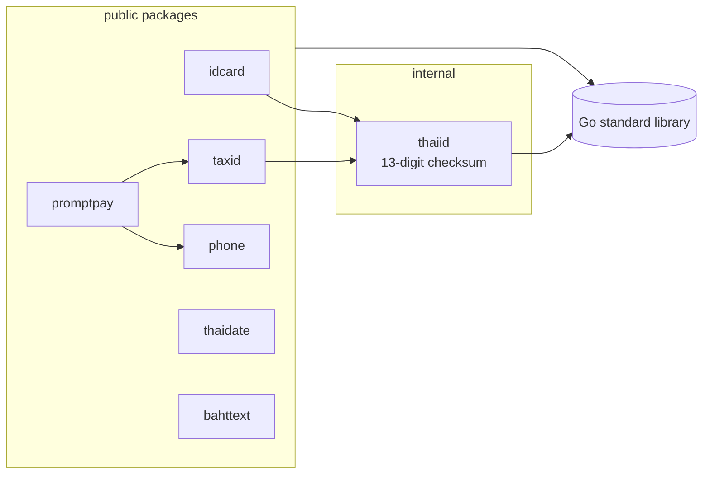

<div align="center">

# thai-utils

**ไลบรารี Go สำหรับข้อมูลเฉพาะของไทย — เลขบัตรประชาชน เลขผู้เสียภาษี เบอร์โทรศัพท์ QR พร้อมเพย์ วันที่แบบ พ.ศ. และการอ่านจำนวนเงินเป็นตัวอักษร ไม่มี dependency ภายนอก**

[](https://github.com/tonklasocute/thai-utils/actions/workflows/ci.yml)
[](https://pkg.go.dev/github.com/tonklasocute/thai-utils)
[](https://goreportcard.com/report/github.com/tonklasocute/thai-utils)
[](go.mod)
[](#การพัฒนา)
[](go.mod)
[](LICENSE)

[English](README.md) · ภาษาไทย

</div>

```go
idcard.Validate("1-1037-02071-81-1")  // true
phone.ToE164("081-234-5678")          // "+66812345678"
promptpay.Payload("0812345678", nil)  // "000201010211…63045D82"
thaidate.Format(t, thaidate.DateFull) // "วันเสาร์ที่ 17 ตุลาคม พ.ศ. 2569"
bahttext.Format(1250.50)              // "หนึ่งพันสองร้อยห้าสิบบาทห้าสิบสตางค์"
```

| แพ็กเกจ | ทำอะไรได้ |
|---------|-----------|
| [`idcard`](#idcard) | เลขประจำตัวประชาชน: ตรวจ check digit, จัดรูปแบบ, สุ่มเลขสำหรับข้อมูลทดสอบ |
| [`taxid`](#taxid) | เลขประจำตัวผู้เสียภาษีอากร ทั้งบุคคลธรรมดาและนิติบุคคล |
| [`phone`](#phone) | เบอร์มือถือและเบอร์บ้าน: ตรวจสอบ, แปลงเป็นรูปแบบมาตรฐาน, E.164, รูปแบบสำหรับแสดงผล |
| [`promptpay`](#promptpay) | สร้าง payload QR พร้อมเพย์ตามมาตรฐาน EMVCo / Thai QR Payment ทั้งแบบไม่ระบุและระบุจำนวนเงิน |
| [`thaidate`](#thaidate) | แปลง พ.ศ./ค.ศ., ชื่อเดือนและวันภาษาไทย, แปลงข้อความ วว/ดด/ปปปป, เลขไทย |
| [`bahttext`](#bahttext) | อ่านจำนวนเงินเป็นตัวอักษรภาษาไทย เหมือนฟังก์ชัน `BAHTTEXT` ของ Excel |

ทุกแพ็กเกจยึดหลักเดียวกัน: **ใช้แค่ standard library**, รับ input ได้หลายแบบ (ขีด เว้นวรรค `+66`)
แต่ตรวจสอบเข้มงวด, มี [sentinel error](#error) ให้ใช้กับ `errors.Is`, มีโปรแกรมตัวอย่างที่รันได้ใน
[`examples/`](examples) และ test coverage 100%

## ติดตั้ง

```sh
go get github.com/tonklasocute/thai-utils
```

ต้องใช้ Go 1.22 ขึ้นไป import เฉพาะแพ็กเกจที่ต้องใช้:

```go
import (
	"github.com/tonklasocute/thai-utils/idcard"
	"github.com/tonklasocute/thai-utils/promptpay"
)
```

---

## idcard

**ดักเลขบัตรที่พิมพ์ผิดก่อนจะลงฐานข้อมูล** หลักที่ 13 ของเลขบัตรประชาชนคือ check digit แบบ mod 11
จึงจับเลขที่พิมพ์ผิดส่วนใหญ่ได้โดยไม่ต้องต่อระบบภายนอก `Check` บอกได้ว่าผิด *เพราะอะไร*
คุณจึงแสดงข้อความที่ตรงจุดให้ผู้ใช้ได้ แทนที่จะบอกแค่ว่า "ไม่ถูกต้อง"

```go
idcard.Validate("1-1037-02071-81-1")  // true
idcard.Validate("1103702071812")      // false: check digit ผิด
idcard.Format("1103702071811")        // "1-1037-02071-81-1", nil
idcard.Normalize("1-1037-02071-81-1") // "1103702071811"
idcard.Generate()                     // เช่น "3849105732112"

switch err := idcard.Check(input); {
case errors.Is(err, idcard.ErrInvalidLength):
	// "เลขบัตรประชาชนต้องมี 13 หลัก"
case errors.Is(err, idcard.ErrInvalidChecksum):
	// "เลขบัตรประชาชนไม่ถูกต้อง"
}
```

```text
$ go run ./examples/idcard
1-1037-02071-81-1    valid   -> 1-1037-02071-81-1
1103702071812        invalid -> check digit mismatch
0105556000017        invalid -> idcard: personal ID must not start with 0
12345                invalid -> idcard: must contain exactly 13 digits
random test ID: 3803820267571
```

> [!WARNING]
> `Generate` มีไว้สำหรับข้อมูลทดสอบเท่านั้น เลขที่สุ่มได้อาจตรงกับเลขของคนจริง

---

## taxid

**ตัวตรวจตัวเดียว ใช้ได้ทั้งบุคคลและบริษัท** บุคคลธรรมดาใช้เลขบัตรประชาชนเป็นเลขผู้เสียภาษี
ส่วนนิติบุคคลได้เลข 13 หลักที่ขึ้นต้นด้วย `0` `taxid` รับได้ทั้งสองแบบ และ `IsJuristic` แยกให้ว่าเป็นแบบไหน

```go
taxid.Validate("0105556000017")   // true
taxid.IsJuristic("0105556000017") // true: นิติบุคคล
taxid.IsJuristic("1103702071811") // false: บุคคลธรรมดา
taxid.Format("0105556000017")     // "0-1055-56000-01-7", nil
```

```text
$ go run ./examples/taxid
0105556000017        0-1055-56000-01-7 (juristic person)
1-1037-02071-81-1    1-1037-02071-81-1 (individual)
0105556000018        invalid: taxid: invalid check digit
```

---

## phone

**เก็บรูปแบบเดียว แสดงผลอีกแบบ** ผู้ใช้พิมพ์มาได้ทั้ง `+66 81 234 5678`, `(02) 123-4567` หรือ `0812345678`
`phone` แปลงทั้งหมดให้เป็นรูปแบบมาตรฐานสำหรับเก็บในฐานข้อมูล, E.164 สำหรับ SMS gateway
และรูปแบบที่อ่านง่ายสำหรับหน้าจอ

```go
phone.Validate("+66 81 234 5678")  // true
phone.Normalize("+66 81 234 5678") // "0812345678", nil
phone.ToE164("081-234-5678")       // "+66812345678", nil
phone.Format("0812345678")         // "081-234-5678", nil
phone.Format("021234567")          // "02-123-4567", nil
phone.Format("053123456")          // "053-123-456", nil
phone.IsMobile("021234567")        // false
```

```text
$ go run ./examples/phone
input              display        E.164          type
0812345678         081-234-5678   +66812345678   mobile
+66 81 234 5678    081-234-5678   +66812345678   mobile
(02) 123-4567      02-123-4567    +6621234567    landline
053123456          053-123-456    +6653123456    landline
+1 415 555 0100    error: phone: country code must be +66
1669               error: phone: unknown number prefix
```

เบอร์มือถือขึ้นต้นด้วย `06`/`08`/`09` ตามด้วยตัวเลข 8 หลัก เบอร์บ้านขึ้นต้นด้วย `02` (กรุงเทพฯ และปริมณฑล) หรือ `03`/`04`/`05`/`07` ตามด้วยตัวเลข 7 หลัก

---

## promptpay

**QR พร้อมเพย์ที่สแกนได้กับแอปธนาคารไทยทุกแอป** สร้าง payload ตามมาตรฐาน EMVCo / Thai QR Payment
ปลายทางเป็นเบอร์มือถือ เลขบัตรประชาชนหรือเลขผู้เสียภาษี 13 หลัก หรือเลข e-Wallet 15 หลักก็ได้
ทั้งแบบไม่ระบุจำนวนเงิน (ผู้จ่ายกรอกเอง) และแบบระบุจำนวนเงิน ผลลัพธ์ตรงกับแพ็กเกจ npm
[`promptpay-qr`](https://github.com/dtinth/promptpay-qr) ทุกไบต์ ตรวจด้วย golden tests

```go
// QR แบบไม่ระบุจำนวนเงิน (ผู้จ่ายกรอกเอง)
payload, err := promptpay.Payload("081-234-5678", nil)

// QR แบบระบุจำนวนเงิน 100.50 บาท ไปยังเลขบัตรประชาชน
payload, err = promptpay.Payload("1-1037-02071-81-1", promptpay.Amount(100.50))
// 00020101021229370016A000000677010111021311037020718115802TH53037645406100.5063041B0C
```

```text
$ go run ./examples/promptpay 0812345678 100
00020101021229370016A000000677010111011300668123456785802TH53037645406100.006304BB8A
```

<details>
<summary><b>วิธีสร้างภาพ QR</b></summary>

`thai-utils` ไม่มี dependency จึงคืนค่าเป็นข้อความ payload แล้วให้คุณเลือกไลบรารีสร้างภาพเอง ตัวอย่างนี้ใช้ [`skip2/go-qrcode`](https://github.com/skip2/go-qrcode):

```go
import (
	"github.com/skip2/go-qrcode"
	"github.com/tonklasocute/thai-utils/promptpay"
)

payload, err := promptpay.Payload("0812345678", promptpay.Amount(250))
if err != nil {
	return err
}
// เขียนไฟล์ PNG ขนาด 256×256 ที่สแกนได้ด้วยแอปธนาคารทุกแอป
err = qrcode.WriteFile(payload, qrcode.Medium, 256, "promptpay.png")
```

ถ้าจะส่งภาพผ่าน HTTP ให้ใช้ `qrcode.Encode` เพื่อรับเป็น PNG bytes แทน

</details>

---

## thaidate

**วันที่ภาษาไทยด้วย layout ของ Go ที่คุ้นเคยอยู่แล้ว** `Format` ใช้ layout แบบเดียวกับ `time.Format`
โดย `2006`/`06` จะเป็นปี พ.ศ., `January`/`Jan` เป็นชื่อเดือนภาษาไทย และ `Monday`/`Mon` เป็นชื่อวันภาษาไทย
token อื่น ๆ ทำงานเหมือน `time.Format` ทุกอย่าง

```go
t := time.Date(2026, time.October, 17, 14, 30, 0, 0, time.UTC)

thaidate.ToBE(2026)                             // 2569
thaidate.ToCE(2569)                             // 2026
thaidate.Format(t, thaidate.DateLong)           // "17 ตุลาคม 2569"
thaidate.Format(t, thaidate.DateShort)          // "17 ต.ค. 69"
thaidate.Format(t, thaidate.DateFull)           // "วันเสาร์ที่ 17 ตุลาคม พ.ศ. 2569"
thaidate.Format(t, "Mon 2 Jan 2006 15:04 น.")   // "ส. 17 ต.ค. 2569 14:30 น."
thaidate.Parse("17/10/2569")                    // 2026-10-17 00:00:00 UTC, nil
thaidate.ToThaiDigits("17/10/2569")             // "๑๗/๑๐/๒๕๖๙"
```

```text
$ go run ./examples/thaidate
Long:    18 ตุลาคม 2569
Short:   18 ต.ค. 69
Full:    วันอาทิตย์ที่ 18 ตุลาคม พ.ศ. 2569
Time:    18 ตุลาคม 2569 เวลา 20:22 น.
Digits:  ๑๘ ตุลาคม ๒๕๖๙
Parsed 13/04/2569 -> 2026-04-13 (Songkran, CE 2026)
```

`Parse` อ่านรูปแบบ วว/ดด/ปปปป (พ.ศ.) และไม่รับวันที่ที่ไม่มีอยู่จริง เช่น `29/02/2569` หรือ `31/04/2569`

---

## bahttext

**บรรทัดจำนวนเงินตัวอักษรที่อยู่บนใบแจ้งหนี้และใบเสร็จทุกใบ** ใช้กฎเดียวกับฟังก์ชัน `BAHTTEXT` ของ Excel
รวมถึง `เอ็ด`, `ยี่สิบ`, `ถ้วน` และ `ล้าน` ซ้อนกันสำหรับตัวเลขขนาดใหญ่

```go
bahttext.Format(21)                    // "ยี่สิบเอ็ดบาทถ้วน"
bahttext.Format(1250.50)               // "หนึ่งพันสองร้อยห้าสิบบาทห้าสิบสตางค์"
bahttext.Format(0.25)                  // "ยี่สิบห้าสตางค์"
bahttext.Format(-100)                  // "ลบหนึ่งร้อยบาทถ้วน"
bahttext.FormatString("1,000,001.00")  // "หนึ่งล้านเอ็ดบาทถ้วน", nil
bahttext.FormatString("1000000000000") // "หนึ่งล้านล้านบาทถ้วน", nil
```

```text
$ go run ./examples/bahttext 1250.50 99.99
         1250.50  หนึ่งพันสองร้อยห้าสิบบาทห้าสิบสตางค์
           99.99  เก้าสิบเก้าบาทเก้าสิบเก้าสตางค์
```

ถ้าจำนวนเงินมาจาก input ของผู้ใช้หรือชนิดข้อมูลทศนิยม แนะนำให้ใช้ `FormatString` เพราะทำงานกับตัวเลขทศนิยมแบบข้อความได้ไม่จำกัดขนาด
และปัดเศษสตางค์แบบปัดครึ่งขึ้นได้แม่นยำ ไม่ติดปัญหาความละเอียดของ `float64`

---

## ทำไมถึงสร้างโปรเจ็กต์นี้

ผมเป็นนักพัฒนาจากกรุงเทพฯ และแทบทุกโปรเจ็กต์ที่ทำต้องใช้งานเฉพาะของไทยชุดเดิม ๆ ตรวจเลขบัตรประชาชนในฟอร์มสมัครสมาชิก
แปลงเบอร์โทรก่อนส่ง OTP พิมพ์วันที่แบบ พ.ศ. ลงเอกสาร ใส่ QR พร้อมเพย์ในใบแจ้งหนี้ เขียนจำนวนเงินเป็นตัวอักษรในใบเสร็จ
ผมคัดลอกโค้ดชุดเดิมไปมาระหว่างโปรเจ็กต์ แต่ละที่ต่างกันนิดหน่อย บางที่มีบั๊กแฝงอยู่ เลยรวบรวมมาเป็นไลบรารีเดียว
ที่ทดสอบครบ ไม่มี dependency มี API ที่สม่ำเสมอ และมี error ที่เอาไปแสดงให้ผู้ใช้ดูได้จริง

## โครงสร้างโปรเจ็กต์

```text
thai-utils/
├── idcard/                 # เลขบัตรประชาชน: Validate, Check, Format, Normalize, Generate
├── taxid/                  # เลขผู้เสียภาษี: API เดียวกับ idcard และเพิ่ม IsJuristic
├── phone/                  # แยกเบอร์มือถือ/เบอร์บ้าน, E.164, รูปแบบแสดงผล
├── promptpay/              # สร้าง payload แบบ EMVCo TLV, CRC16-CCITT, จัดการจำนวนเงิน
├── thaidate/               # พ.ศ. ↔ ค.ศ., แปลง layout ต่อจาก time.Format, Parse, เลขไทย
├── bahttext/               # ตัวเลข → คำอ่านภาษาไทย รองรับทศนิยมแบบข้อความทุกขนาด
├── internal/thaiid/        # check digit 13 หลักแบบ mod 11 ที่ idcard และ taxid ใช้ร่วมกัน
├── examples/<package>/     # โปรแกรมตัวอย่างที่รันได้ แพ็กเกจละหนึ่งตัว
├── .github/workflows/      # CI: vet, lint, race tests บน Linux/macOS/Windows กับ Go 1.22 และ stable
├── .golangci.yml
└── Makefile
```



หลักการออกแบบ:

- **ไม่มี dependency ภายนอก** ใช้แค่ standard library จึงไม่มีแพ็กเกจอื่นติดเข้ามาใน `go.sum` ของคุณ
- **แพ็กเกจเล็กและแยกกัน** import `bahttext` ได้โดยไม่ต้องลาก PromptPay มาด้วย โค้ดที่ใช้ร่วมกันมีแค่ check digit
  ใน `internal/thaiid` และ `promptpay` เรียกใช้ `phone` กับ `taxid` เพื่อตรวจปลายทาง
- **รับ input ได้หลายแบบ แต่ตรวจสอบเข้มงวด** มีขีด เว้นวรรค วงเล็บ หรือขึ้นต้นด้วย `+66` ก็ใช้ได้
  แต่ check digit ผิด prefix ที่ไม่รู้จัก หรือวันที่ที่ไม่มีอยู่จริงจะไม่ผ่าน
- **ใช้พร้อมกันหลาย goroutine ได้** ไม่มี state ที่เปลี่ยนแปลงได้ในแพ็กเกจ และไม่มี I/O
- **ตรวจกับ implementation อ้างอิง** table-driven tests ครอบคลุม input ที่ไม่ถูกต้อง ทุก identifier ที่ export
  มี `Example` ที่รันได้ และ payload พร้อมเพย์ตรวจกับผลลัพธ์ golden จาก `promptpay-qr`

## Benchmark

วัดด้วย `make bench` บน Intel Core i7-10700 (8 คอร์ / 16 เธรด), Windows 11, Go 1.26

| Benchmark | เวลา | หน่วยความจำ | จำนวน allocation |
|---|---:|---:|---:|
| `idcard.Validate` | **78 ns/op** | 16 B/op | 1 |
| `bahttext.FormatString` | 260 ns/op | 480 B/op | 2 |
| `thaidate.Format` | 459 ns/op | 240 B/op | 6 |
| `promptpay.Payload` | 1.8 µs/op | 360 B/op | 14 |

เร็วพอจะตรวจทุกแถวของไฟล์ CSV ขนาดใหญ่ได้สบาย ๆ

## Error

ทุกแพ็กเกจมี sentinel error ให้ใช้กับ `errors.Is` เพื่อบอกผู้ใช้ได้ตรงจุดว่าผิดตรงไหน

| แพ็กเกจ | Error |
|---|---|
| `idcard` | `ErrInvalidCharacter` `ErrInvalidLength` `ErrLeadingZero` `ErrInvalidChecksum` |
| `taxid` | `ErrInvalidCharacter` `ErrInvalidLength` `ErrInvalidChecksum` |
| `phone` | `ErrInvalidCharacter` `ErrInvalidCountryCode` `ErrInvalidPrefix` `ErrInvalidLength` |
| `promptpay` | `ErrInvalidTarget` `ErrInvalidAmount` |
| `thaidate` | `ErrInvalidFormat` `ErrInvalidDate` |
| `bahttext` | `ErrInvalidNumber` |

## การพัฒนา

```sh
make test      # go test -race ./...
make cover     # รายงาน coverage (coverage.out, coverage.html)
make lint      # golangci-lint
make fmt       # gofmt + goimports
make bench     # benchmark
make examples  # รันโปรแกรมตัวอย่างทั้งหมด
```

## ร่วมพัฒนา

ยินดีรับ contribution ทุกรูปแบบ โดยเฉพาะยูทิลิตีใหม่ ๆ ที่เกี่ยวกับข้อมูลของไทย เช่น ที่อยู่และรหัสไปรษณีย์ ป้ายทะเบียนรถ รูปแบบเลขบัญชีธนาคาร หรือปฏิทินจันทรคติไทย

1. ถ้าเป็นการเปลี่ยนแปลงใหญ่ เปิด issue พูดคุยกันก่อนเริ่มทำ
2. ไม่เพิ่ม dependency ใช้แค่ standard library
3. เขียน table-driven tests (รวมกรณี input ไม่ถูกต้อง) และฟังก์ชัน `Example` สำหรับทุก identifier ที่ export ใหม่ coverage ควรอยู่ที่หรือใกล้ 100%
4. รัน `make fmt lint test` ก่อนเปิด pull request
5. เขียน commit message ตาม [Conventional Commits](https://www.conventionalcommits.org/) เช่น `feat(phone): support 1-800 numbers`

ถ้าเจอผลลัพธ์ที่ไม่ถูกต้อง เช่น สะกดคำภาษาไทยผิด หรือ payload ที่แอปธนาคารไม่รับ ช่วยเปิด issue พร้อม input และผลลัพธ์ที่ควรได้

## สัญญาอนุญาต

[MIT](LICENSE) © Khomkrit Daengnuan
